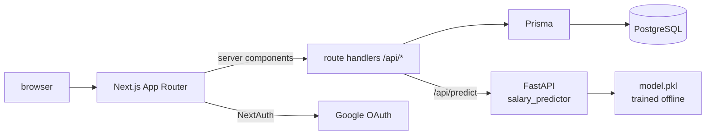

# CompIQ

**Compare offers by level, not by job title — because "L5" and "E5" are the same job and "Senior" is not.**

CompIQ normalises each company's internal level onto one ordered scale, stores the
normalised level and its rank on every salary row, and reports distributions as
median and percentile rather than mean.

`Next.js 15` `TypeScript` `Prisma` `PostgreSQL` `NextAuth` `Tailwind` · `FastAPI` (predictor)

**[Live demo →](https://compiq-three.vercel.app)**

---

## Why this exists

Salary sites compare by title, and titles do not translate across companies. Two
people at identical seniority read as different jobs, and an "average compensation"
hides the shape of the distribution that actually matters when you negotiate. The
unit of comparison should be *level and total comp*, with the mapping between levels
visible enough to argue with.

## Architecture



| Route | Purpose |
| :-- | :-- |
| `GET /api/salaries` | filter by company, level, role, country |
| `POST /api/salaries` | submit (auth required; validated; 30-day duplicate guard) |
| `GET /api/companies`, `/api/companies/[slug]` | list with stats, detail with level breakdown |
| `GET /api/compare` | side-by-side comparison payload |
| `GET /api/levels` | level taxonomy and equivalences |
| `GET /api/stats` | platform aggregates |
| `POST /api/predict` | total-comp prediction (proxies the FastAPI service) |

**Data model.** `Company` (name, slug, aliases, industry) → `Salary`
(role, raw `level`, `normalizedLevel`, `levelOrder`, base / bonus / equity,
`totalComp`, location, country, currency, `yearsExp`, `verified`, `flagged`) →
`LevelMap` (company, raw → normalised level and order). Indices on
`companyId`, `level`, `role`, `country` cover the filter surface that the UI exercises.

## Design decisions

1. **Levels are data, not branches.** `normalizeLevel()` is a pure function over one
   explicit map, and the result is *written onto the row* (`normalizedLevel`,
   `levelOrder`). Reads never re-derive equivalence, sorting by seniority is an integer
   sort, and correcting a mapping is a migration over stored rows instead of a change
   to every query.
2. **Median and percentile, never mean.** Compensation is right-skewed — a single
   principal-level outlier can move a mean by more than a level's worth of difference.
   `lib/stats.ts` exposes median and percentile only, so it is impossible to
   accidentally ship an average.
3. **Total comp is computed once, on write.** `calculateTotalComp(base, bonus, equity)`
   runs in the submission path and the result is stored, so a later change to the
   formula is a versioned decision rather than a silent retro-edit of history.
4. **Validation at the boundary.** The submission route parses with a schema before
   touching Prisma: negative values are a `400`, unauthenticated writes a `401`, and a
   repeat submission from the same user for the same company/level/role inside 30 days
   is a `409` — duplicate rows would double-count a level without failing anything.
5. **Company identity is canonicalised.** `normalizeCompanyName()` maps aliases
   (`aws`, `alphabet`, `facebook`) onto one canonical name and the slug is derived from
   it, so "AWS" and "Amazon" cannot become two companies with two incomparable medians.
6. **The predictor is a separate service.** Scikit-learn lives behind FastAPI with a
   typed request (`years_of_experience: 0…50`), so a slow or broken model cannot take
   the site down, and CORS is pinned to the app origin plus `*.vercel.app` previews.

## Quick start

```bash
git clone https://github.com/sheikhayaan/compiq && cd compiq
npm install
# create .env.local with:
#   DATABASE_URL=postgresql://…      NEXTAUTH_SECRET=…
#   NEXTAUTH_URL=http://localhost:3000
#   GOOGLE_CLIENT_ID=…               GOOGLE_CLIENT_SECRET=…
npx prisma db push
npx prisma db seed             # 15 companies → 360 salary rows, deterministic
npm run dev                    # http://localhost:3000
```

Predictor (optional):

```bash
cd salary_predictor
pip install -r requirements.txt
uvicorn main:app --port 8000    # loads model.pkl
```

## Tests and checks

```bash
npm run lint
npx tsc --noEmit
npx prisma validate
```

There is no automated test suite yet — the checks above are type, lint and schema
validation, and the submission edge cases (401 / 400 / 409) are enforced in
`app/api/salaries/route.ts` rather than asserted by a test.

## Limits

- **The public deployment reads a checked-in dataset.** `lib/mockData.ts` keeps the
  demo up without a database; the Prisma routes behind it serve the same shape, so the
  deployed site demonstrates the product, not live submissions.
- **Seed data is synthetic** — 360 rows generated by `prisma/seed.ts` from a per-company
  country distribution, not scraped from anywhere. Numbers are plausible, not real.
- **The predictor is a small offline model**, trained on that synthetic set. It is a
  demonstration of the serving path, not a compensation oracle.

## Author

**Mohd Ayaan** — [github.com/sheikhayaan](https://github.com/sheikhayaan) ·
[LinkedIn](https://linkedin.com/in/mohd-ayaan-7731b4381)
